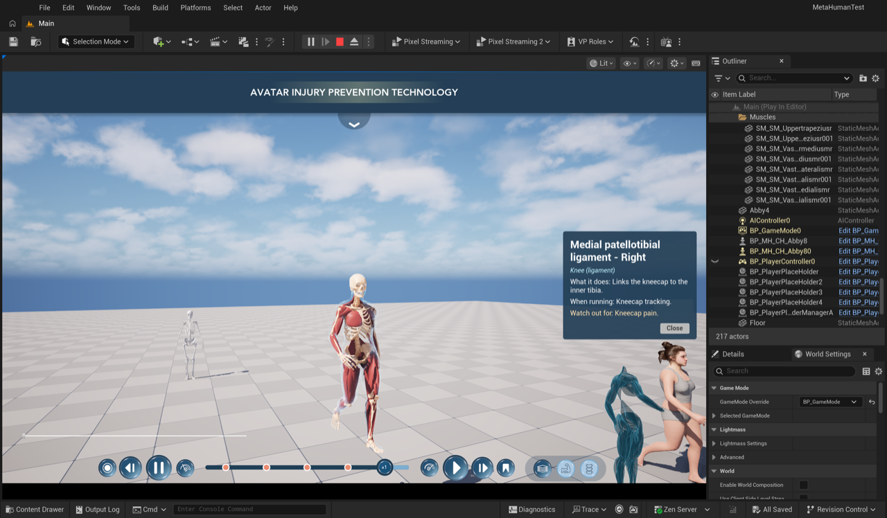
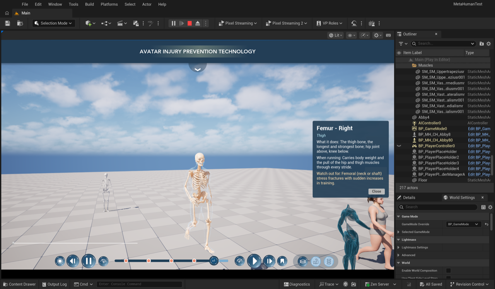
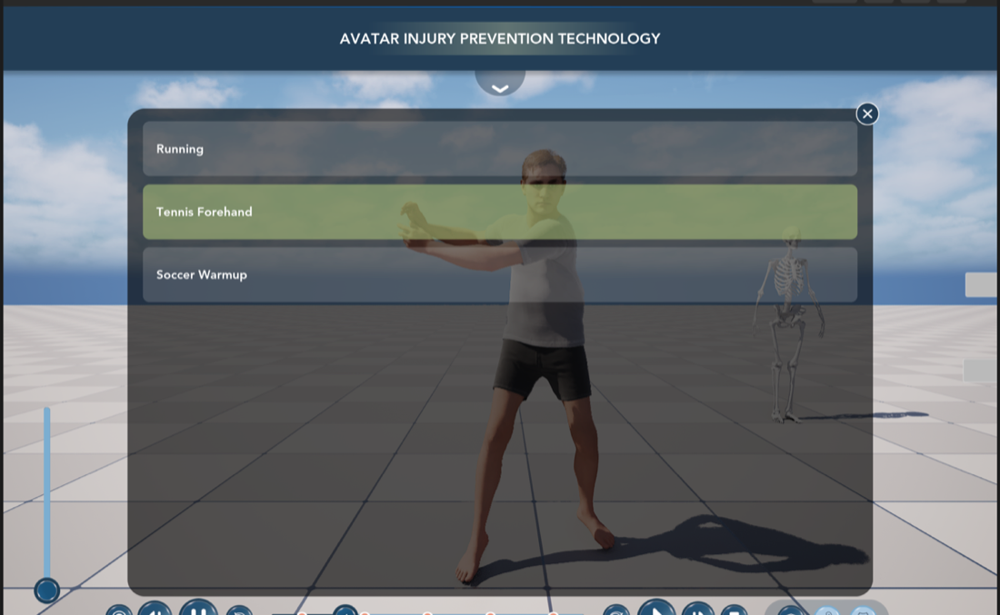
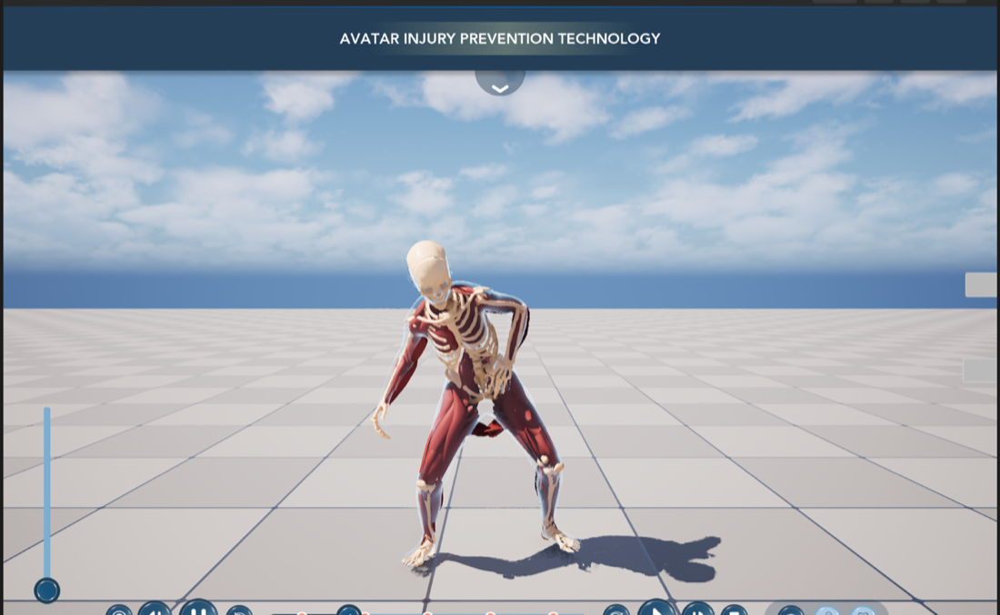

# MetaHuman Anatomy × IHPC UI

Merging two branches of the **MetaHumanTest** Unreal Engine 5.8 project into one:

| Source | GitHub | Local copy (Perforce workspace) | What it brings |
|---|---|---|---|
| **Abby anatomy branch** | [MatinEsmaeili00/Abby-MetaHuman-Animation](https://github.com/MatinEsmaeili00/Abby-MetaHuman-Animation) | `Claude/MetaHumanTestCopy2Mac` | Anatomy layers (skin → muscles → skeleton) that follow Abby's walk / jog / run, animation timeline component, upright posture + running-neck fix, Beau as a second person, muscle hover / click info |
| **IHPC UI branch** | [mblumpkin/MetaHumanTest](https://github.com/mblumpkin/MetaHumanTest) | `Claude/MetaHumanTestCOPY2` | The Figma "Avatar Injury Prevention Program" UI: HUD + menu, analysis panel, timeline / playback bar, **Body / Muscles / Skeleton layer switcher** |

**Target:** `Claude/MetaHumanTestCOPY2` (now continued in its copy **`Claude/MetaHumanTestCOPY2B`**, which has the
team's manual changes) gets all of the Abby branch's functionality, driven by the **new IHPC UI**
(the layer-switcher buttons switch the skin layers, no opacity slider), and the anatomy layers use the
**segmented muscles** (`SM_SM_*`, the `Muscles` folder in `Main`) and a **segmented skeleton**, so every muscle and
bone is its own labelled part.

| Muscles view (IHPC **Muscles** button), info popup | Skeleton view, femur selected |
|---|---|
|  |  |

**Latest (2026-11-08, COPY2B):** the IHPC **Actions** menu plays Running / Tennis Forehand / Soccer Warmup on the
avatar (with the timeline, muscles and skeleton following); **Madi** is a new switchable anatomy character (Grant is
scripted and waits for a MetaHuman login); the layer buttons are exactly **1 / 0.5 / 0** (skin / muscles / bones);
the hover / click **glow** now lights the right muscle or bone. → [docs/06](docs/06-actions-characters-highlight.md)

| Actions panel (playing action green) | Madi, Soccer Warmup, Muscles view |
|---|---|
|  |  |

**Status:** merged and working in Play-In-Editor — IHPC HUD, timeline bar and layer switcher drive Abby's / Beau's
anatomy; 186 segmented muscles and a 200-bone segmented skeleton follow walk / jog / run with a name, side, region
and info text for every part. Details and remaining items: [TODO.md](TODO.md).

- **Progress / to-do:** [TODO.md](TODO.md)
- **Full system documentation (architecture, classes, assets, data flow):** [docs/00-system-overview.md](docs/00-system-overview.md)
- **Investigation (what each project has, what conflicts):** [docs/01-investigation.md](docs/01-investigation.md)
- **What's in the BlenderContent folder:** [docs/02-blender-content.md](docs/02-blender-content.md)
- **Merge steps (C++ + assets):** [docs/03-merge.md](docs/03-merge.md)
- **Segmented muscles + skeleton (fitting, skinning, labels):** [docs/04-segmented-anatomy.md](docs/04-segmented-anatomy.md)
- **Tests (PIE), known limitations:** [docs/05-testing.md](docs/05-testing.md)
- **Actions menu, Madi / Grant, layer buttons 1 / 0.5 / 0, highlight fixes (2026-11-08):** [docs/06-actions-characters-highlight.md](docs/06-actions-characters-highlight.md)

## Repo layout

| Path | What |
|---|---|
| `project/` | Mirror of the merged project's text files (`.uproject`, `Config/`, `Source/`, the plugin) and only the `.uasset` files this work created or changed. The full project (~7 GB) stays in Perforce. |
| `docs/` | Documentation, findings, screenshots |
| `scripts/ue_jobs/` | Unreal editor Python jobs, in the order they were run |
| `scripts/blender_jobs/` | Blender Python jobs (mesh processing, weights, IDs) |
| `data/` | Muscle names + info text, bone info text, part tables (IDs, sides, regions, bones, picking samples) |
| `tools/ue/add_metahuman_pawn.sh` | Assemble a MetaHuman Character and add it as a switchable anatomy pawn (jobs 19 → 16 → 17) |
| `tools/ue/` | Editor launcher, file bridge (`claude_bridge.py` / `ue_bridge.py`), MCP client (`ue_mcp.py`, `uescript.py`), PIE driver (`pie.sh`), screenshots (`pie_shot.sh`, `capture*.sh`), build (`build_copy2.sh`) |
| `tools/blender/` | Blender inventory / alignment helpers |
| `tools/sync_from_project.sh`, `tracked_assets.txt` | Mirror the project's changed files into `project/` |

## How Claude talks to the tools

* **Unreal:** UE 5.8's experimental *Unreal MCP* plugin (`ModelContextProtocol` + `AllToolsets`). Each project serves
  its own port: `MetaHumanTestCopy2Mac` → `127.0.0.1:8000/mcp`, `MetaHumanTestCOPY2` / `COPY2B` → `127.0.0.1:8001/mcp`
  (`Config/DefaultEditorPerProjectUserSettings.ini`, auto-start on). Full editor Python goes through a file-based
  bridge (`tools/ue/claude_bridge.py`, started by `tools/ue/launch_copy2.sh`).
* **Blender:** *MCP for Blender* add-on (localhost:9876) for the live session, and headless `Blender -b` for batch jobs.
* **GitHub:** `gh` CLI.
