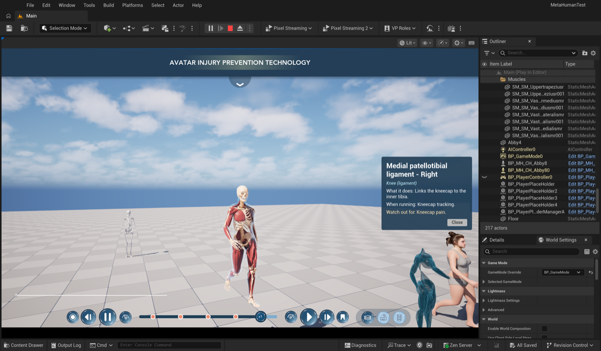

# 00 — System overview

The merged **MetaHumanTest** project (`Claude/MetaHumanTestCOPY2`, Unreal Engine 5.8): the IHPC Figma UI driving
Abby's (and Beau's) anatomy layers, gait timeline and muscle / bone information, with segmented anatomy.



## 1. What the user sees

| UI (IHPC, Figma "Avatar Injury Prevention Program") | Does |
|---|---|
| **Title bar + menu** (`WBP_IHPC_HUD`) | Profile, Progress, Saved Videos, History & Timeline, Settings; panels close with the round X |
| **Analysis panel** (Saved Videos) | Graphs, Active Muscles, Tagged Points, video cards that jump the animation (demo data) |
| **Timeline / playback bar** (`WBP_IHPC_Timeline`, bottom centre) | Record, restart, pause, slower / faster (×0.25…×3), scrub, play, next marker, bookmark — drives the pawn's `UAnimationTimelineComp` |
| **Actions menu** (4th tab "Actions" → panel with `Action_Running`, `Action_TennisForehand`, `Action_SoccerWarmup`) | Plays that clip on the possessed pawn (`UAnimationTimelineComp::PlayAction`); playing action green; click again → walk / jog / run ([docs/06](06-actions-characters-highlight.md)) |
| **Layer switcher** (`WBP_IHPC_LayerSwitcher`, bottom right) | Skin amount **1 / 0.5 / 0**: **Body** = skin, **Muscles** = segmented muscles (skin as an x-ray shell), **Skeleton** = segmented skeleton — `UAnatomyViewComp::SetRevealDepth(1 − amount)`, animated, no opacity slider |
| **Hover / click** in the Muscles or Skeleton view (`WB_MuscleInfo`) | Tooltip "*name (side)*" at the mouse; click → popup: name – side, region, *What it does*, *When running*, *Watch out for*, Close |
| **Pawn switcher** (`WB_PawnSwitcher`) | Abby → Beau → skeleton model → **Madi** (→ Grant once assembled); every widget re-binds to the new pawn |
| **Speed slider** (`BP_SpeedSlider`) | Gait speed: walk → jog → run |
| Mouse | Right-drag orbit, left-drag pan, wheel zoom (`UCPP_MouseFunctionComp`) |

## 2. Architecture (one rule)

The **PlayerController** owns input and creates the widgets. **Widgets only forward clicks** and mirror state.
**Components on the possessed pawn do the work.** Possessing another pawn re-binds the widgets, so the same buttons
drive whichever character is active; a widget greys out if the pawn lacks its component.

```
CPP_PlayerController  (BP_PlayerController)
 ├─ BeginPlay creates ── BP_SpeedSlider ──────────────────────► pawn "Speed" (walk/jog/run blend)
 │                    ── WBP_IHPC_LayerSwitcher ──────────────► UAnatomyViewComp       Skin / Muscles / Skeleton
 │                    ── WB_PawnSwitcher ─────────────────────► CPP_PlayerController::SwitchPawn
 │                    ── WB_MuscleInfo (Z 20) ◄──────────────── UAnatomyPickerComp ×2  (AnatomyPicker, BonePicker)
 │                    ── WBP_IHPC_HUD (Z 10) ─ WBP_IHPC_Timeline ─► UIHPCUILibrary ─► UAnimationTimelineComp
 │                                          └ WBP_IHPC_AnalysisPanel (cards / markers seek the timeline)
 ├─ PlayerTick: UpdateMusclePicking → every UAnatomyPickerComp on the pawn (mouse ray, click)
 └─ input: mouse orbit / pan / zoom ──────────────────────────► UCPP_MouseFunctionComp (spring arm)

UAnimationTimelineComp ─► ABP_*_Timeline (UCPP_LocomotionAnimInstance): walk / jog / run at an explicit gait phase
```

## 3. Characters

`BP_MH_CH_Abby8` (spawned by `BP_GameMode`), `BP_Beau_Pawn` and `BP_Madi_Pawn` (2026-11-08, a copy of Beau's pawn
with Madi's assembled MetaHuman parts, same `ABP_Beau_Timeline` because both use `metahuman_base_skel`) share the
same layout:

```
Root
└─ Body          SkeletalMesh  MetaHuman body, Anim Class = ABP_Abby_Timeline / ABP_Beau_Timeline   ← leader
   ├─ Face, Hair, (outfit)     MetaHuman parts, Leader Pose
   ├─ MuscleMesh   SKM_Anatomy_Muscles_Segmented   186 parts, smooth weights   Leader Pose → Body
   └─ SkeletonMesh SKM_Anatomy_Skeleton_Segmented  200 parts, rigid weights    Leader Pose → Body
Components
   AnatomyView     UAnatomyViewComp    layers Skin (everything else) / Muscles (MuscleMesh) / Skeleton (SkeletonMesh)
   AnatomyPicker   UAnatomyPickerComp  DA_Atlas_Muscles_Segmented, mesh MuscleMesh, layer Muscles, radius 2 cm
   BonePicker      UAnatomyPickerComp  DA_Atlas_Skeleton_Segmented, mesh SkeletonMesh, layer Skeleton, radius 1.5 cm
   AnimationTimeline UAnimationTimelineComp   (gait cycle 0.967 s, looping) + ActionClips {Running, TennisForehand, SoccerWarmup}
   MouseFunction   UCPP_MouseFunctionComp
```

**Leader Pose:** the anatomy meshes use Abby's skeleton (a plugin copy with the same bone names and the exact same
reference pose), so they copy the body's bone transforms every frame — no extra Anim Blueprint; they follow anything
that drives the body (the timeline ABP, Sequencer, Live Link). On Beau the same meshes follow *his* bones.

**Layer visibility:** `UAnatomyViewComp` keeps a reveal depth (0 = skin … 1 = skeleton). The skin switches straight
to an x-ray shell (`M_Anatomy_XRay`) when it leaves depth 0, the muscle layer fades with `M_Anatomy_MuscleFade`,
fully faded meshes are hidden but keep ticking so Leader Pose followers keep animating.

**Picking:** each atlas entry has the part's ID (also in the mesh's vertex colour, R = (id + 0.5) / 255) and points
on the part stored relative to a bone. Every frame the picker places those points on the animated skeleton and takes
the front-most part whose point lies within the pick radius of the mouse ray. A picker only works while its layer is
the outermost visible one, so muscles and bones never compete. The hovered / selected part glows through a highlight
copy of the mesh, one per picker (`AnatomyPicker_Highlight_0`, `BonePicker_Highlight_0`;
`M_Anatomy_MuscleHighlight` compares the vertex-colour ID — the GPU byte R = ID since job 18 fixed the encoding).

## 4. Code map

| Where | Class | Role |
|---|---|---|
| `Plugins/MetaHumanAnatomyLayers` | `UAnatomyViewComp` | Layers from the outside in, reveal depth, animated `ShowLayer`, fade / x-ray materials |
| | `UAnatomyPickerComp` | Hover / click picking of labelled parts, highlight |
| | `UMuscleAtlas` (`FMuscleInfo`, `FMuscleSample`) | Per-part ID, key, name, side, region, function / running / injury, samples |
| `Source/MetaHumanTest` | `CPP_PlayerController` | Creates widgets (incl. IHPC HUD), input, pawn switching, drives **all** pickers |
| | `UAnimationTimelineComp`, `IAnimationTimelineSource` | Play / pause / reverse / scrub / step the gait cycle; `PlayAction` / `StopAction` play named action clips instead of the locomotion |
| | `UCPP_LocomotionAnimInstance` | Walk / jog / run at an explicit phase; running-neck correction |
| | `UCPP_UW_MuscleInfo` | Tooltip + popup; listens to **every** picker on the pawn |
| | `UCPP_UW_AnatomyViewSwitcher` | Base of the layer switcher: binds to the pawn's `UAnatomyViewComp`, re-binds on possession |
| | `UCPP_MouseFunctionComp` | Orbit / pan / zoom (now `BlueprintCallable`) |
| `Source/MetaHumanTest/*/IHPC_UI` | `UCPP_UW_IHPCHud`, `…Timeline`, `…AnalysisPanel`, `…GraphAccordion`, `…VideoCard`, `…ToggleSwitch`, `…NavTab`, `…LineGraph`, `…ListRow`, `…VideosRow` | The Figma UI (one C++ class + one Widget Blueprint each) |
| | `UCPP_UW_IHPCLayerSwitcher` | Body / Muscles / Skeleton → skin amounts 1 / 0.5 / 0 (`bUseSkinAmounts`; off = `ShowLayer` by layer name) |
| | `UCPP_UW_IHPCHud` | … + Actions menu: binds every `Action_<Name>` button (`UIHPCActionButtonProxy`), `SelectAction`, highlight / greyed out |
| | `UIHPCUILibrary` | Finds the pawn's timeline; play / pause / seek / speed (`IsPlaying()` after the merge) |

## 5. Asset map

| Path | What |
|---|---|
| `/Game/Blueprints/BP_PlayerController` | Widget classes: HUD `WBP_IHPC_HUD`, layer switcher `WBP_IHPC_LayerSwitcher`, speed slider, pawn switcher, muscle info; pawn list Abby8 → Beau → skeleton model |
| `/Game/Blueprints/BP_GameMode` | Default pawn `BP_MH_CH_Abby8` |
| `/Game/UserInterface/IHPC/Widgets/WBP_IHPC_*` | IHPC widgets (look); textures in `…/IHPC/Textures` |
| `/Game/Widget/WB_MuscleInfo`, `WB_PawnSwitcher` | Abby-branch widgets (`WB_AnatomyViewSwitcher`, `WB_AmationTimeline` kept, not created) |
| `/Game/MetaHumans/MH_CH_Abby5/BP_MH_CH_Abby8` | Abby |
| `/Game/MadisonTesting/BeauMHCharacter/BP_Beau_Pawn` | Beau |
| `/Game/MadisonTesting/MadiMHCharacter/BP_Madi_Pawn`, `…/Unpacked/MHC_Madi/` | Madi (pawn, assembled MetaHuman) |
| `/Game/MadisonAnimations/AS_*`, `/Game/MadisonAnimations/MetaHuman/AS_*_MH` | Action clips (Abby's skeleton; retargeted to `metahuman_base_skel`) |
| `/Game/Abby_Animation/Enhanced/ABP_Abby_Timeline`, `/Posture/*_Upright` | Timeline locomotion ABP, upright walk / jog / run |
| `/MetaHumanAnatomyLayers/Anatomy/Segmented/` | `SKM_Anatomy_Muscles_Segmented`, `SKM_Anatomy_Skeleton_Segmented`, `SK_Anatomy_MetaHumanBody`, `DA_Atlas_Muscles_Segmented`, `DA_Atlas_Skeleton_Segmented` |
| `/MetaHumanAnatomyLayers/Anatomy/Materials/` | Muscle, bone, fade, x-ray, hidden, highlight materials |
| `/MetaHumanAnatomyLayers/Anatomy/Meshes/` | The old Emil upper-body layers (no longer used by the characters) |
| `/Game/3D_Models/Muscle/RightSideM/SM_SM_*` + level folder `Muscles` | Source of the segmented muscles (still in the level, 1 m beside Abby's spawn) |

## 6. Data and pipelines

| Step | Tool | Output |
|---|---|---|
| Skeleton fit + export | Blender, [`scripts/blender_jobs/01_export_fitted_skeleton.py`](../scripts/blender_jobs/01_export_fitted_skeleton.py) | `local/skeleton_segmented.fbx`, [`data/skeleton_parts.json`](../data/skeleton_parts.json) |
| Abby's reference pose | UE, [job 07](../scripts/ue_jobs/07_dump_body_ref_pose.py) | `Saved/ClaudeBridge/abby_ref_pose.json` (342 bones) |
| Build layers | UE Geometry Script, [job 08](../scripts/ue_jobs/08_build_segmented_anatomy.py) `muscles` / `skeleton` / `samples_*` | the two skeletal meshes, [`data/segmented_*.json`](../data/) |
| Labels | [job 10](../scripts/ue_jobs/10_build_atlases.py) + [`data/muscle_info.json`](../data/muscle_info.json), [`data/bone_info.json`](../data/bone_info.json), [`data/muscle_names.json`](../data/muscle_names.json) | the two atlases |
| Wire | [job 11](../scripts/ue_jobs/11_wire_segmented_layers.py), [job 13](../scripts/ue_jobs/13_pick_radius.py) | Abby8 / Beau components |

| Action clips → MetaHuman skeleton | [job 15](../scripts/ue_jobs/15_retarget_actions_to_metahuman.py) (`RTG_MH_IKRig`) | `/Game/MadisonAnimations/MetaHuman/AS_*_MH` |
| New character | [job 19](../scripts/ue_jobs/19_assemble_metahuman.py) assemble → [job 16](../scripts/ue_jobs/16_make_metahuman_pawn.py) pawn → [job 17](../scripts/ue_jobs/17_wire_actions_and_layers.py) clips + fade lengths (`tools/ue/add_metahuman_pawn.sh`) | `BP_<Name>_Pawn` in the pawn switcher |
| Vertex-colour IDs | [job 18](../scripts/ue_jobs/18_fix_part_id_vertex_colors.py) (idempotent) | GPU byte R = part ID |

To change a muscle's text: edit `data/muscle_info.json`, run job 10. To rebuild a layer after changing its source:
run job 08 for it (it recreates the mesh asset), then job 08 `samples_*` and job 10.

## 7. Tooling (how Claude drives the editors)

| Tool | Use |
|---|---|
| `tools/ue/launch_copy2.sh` | Opens COPY2 with the MCP server (port 8001) and the file bridge |
| `tools/ue/claude_bridge.py` + `ue_bridge.py` | Run any editor Python: drop a script in `Saved/ClaudeBridge/inbox`, read `outbox` |
| `tools/ue/ue_mcp.py`, `uescript.py` | Unreal MCP (toolsets: actors, assets, Blueprints, meshes, PIE, captures) |
| `tools/ue/pie.sh` | Drive PIE: `layer:muscles`, `depth:0.33`, `switch:1`, `play`, `orbit:dx,dy`, `zoom:n`… |
| `tools/ue/pie_shot.sh` | PIE screenshot with UI (`Shot showui`), through the bridge |
| `tools/ue/build_copy2.sh` | Build + point `UnrealEditor.modules` at the newest library (see note) |
| `tools/sync_from_project.sh` | Mirror the project's changed files into `project/` (token redacted) |

**Build note:** while *another* Unreal Editor runs (e.g. the Copy2Mac project), UnrealBuildTool uses hot-reload
library names (`…-0002.dylib`) and does not update `Binaries/Mac/UnrealEditor.modules`, so a freshly opened editor
loads the previous build. `build_copy2.sh` fixes the manifest after building.

**PIE note:** start / stop PIE through the bridge (`LevelEditorSubsystem.editor_request_begin_play / end_play`).
An MCP `StartPIE` sent while the MCP server is still registering toolsets left the server unresponsive.
