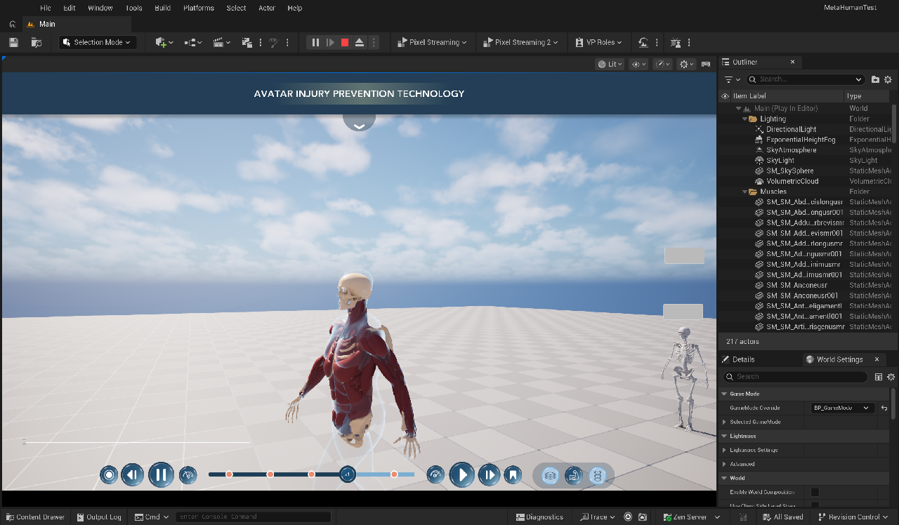

# 03 — Merge: Abby's functionality into the IHPC project (COPY2)

Target: `Claude/MetaHumanTestCOPY2`. Every COPY2 file that gets replaced or edited is first copied to
`MetaHumanTestCOPY2/Saved/ClaudeBackup/2026-11-07_before_merge/` (71 files: `Source/`, `Config/`, `.uproject`,
`BP_PlayerController`, `BP_GameMode`, `BP_SpeedSlider`, `Widget/*`, `BP_MH_CH_Abby8`, `Main.umap`).

## Step 1 — C++

1. **Source = Abby's Source + `IHPC_UI/`.** `rsync --delete --exclude IHPC_UI/` from `MetaHumanTestCopy2Mac/Source`.
   This also removes `CPP_WBP_SpeedSlider` (editor-only class Abby removed together with the `UMGEditor` dependency).
2. **Plugin** `Plugins/MetaHumanAnatomyLayers` copied (without `Binaries/` / `Intermediate/`, so it is rebuilt).
3. **`.uproject`** = Abby's (adds `MetaHumanAnatomyLayers`, drops `UMGEditor` from the module's dependencies; both
   already had the MCP plugins).
4. **Re-applied the IHPC additions to Abby's `CPP_PlayerController`:**
   * `.h`: forward-declared `UCPP_UW_IHPCHud`; `MainHUDWidgetClass`, `MainHUDZOrder = 10`, `GetMainHUD()`,
     private `MainHUDWidget`.
   * `.cpp`: `#include "IHPC_UI/CPP_UW_IHPCHud.h"`; in `BeginPlay`, after the muscle-info widget:
     `MainHUDWidget = AddWidget(MainHUDWidgetClass, MainHUDZOrder);` (Abby's `AddWidget` helper, so the HUD is created
     like every other widget). Z-order: other widgets 0 → **HUD 10** → muscle tooltip / popup 20 (stays on top).
   * `Build.cs`: nothing to add — Abby's already lists `UMG`, `Slate`, `SlateCore`.
5. **`IHPCUILibrary::IsAvatarPlaying`**: `Timeline->bIsPlaying` → `Timeline->IsPlaying()` (the rewritten
   `UAnimationTimelineComp` keeps a play *state* — forward / reverse / paused — instead of a bool).
6. **`UCPP_UW_IHPCLayerSwitcher` rewritten** (header + cpp):
   * Gone: the `BodyFade / MusclesFade / SkeletonFade` values, moving the parent's hidden slider, the
     `WholePart / SkeletonPart / FacePart` tag check.
   * New: `BodyLayerName = "Skin"`, `MusclesLayerName = "Muscles"`, `SkeletonLayerName = "Skeleton"`.
     `SelectLayer` → `AnatomyComp->ShowLayer(index)` (animated). The index is found by name, falling back to
     outermost / second / innermost if a pawn names its layers differently.
   * `AnatomyComp` comes from the parent (`UCPP_UW_AnatomyViewSwitcher`, Abby version), which finds the
     `UAnatomyViewComp` on the possessed pawn, re-binds on `OnPossessedPawnChanged` and greys the widget out when the
     pawn has none. `NativeTick` notices a new component and **highlights the button that matches the new pawn's
     current layer** (`SyncSelectionFromPawn`).
   * `OnLayerChanged(Layer, RevealDepth)` (was `(Layer, Fade)`; nothing in the Widget Blueprints bound it).
7. **Build:** `Build.sh MetaHumanTestEditor Mac Development -Project=…/MetaHumanTestCOPY2/MetaHumanTest.uproject`
   → **Succeeded**, 34 actions (all IHPC classes + the plugin), no warnings from project code.

## Step 2 — Assets (copied from `MetaHumanTestCopy2Mac` with both editors' COPY2 instance closed)

| Copied | Why |
|---|---|
| `Abby_Animation/Enhanced/` (`ABP_Abby_Timeline`, sync clips, `ABP_Abby_Enhanced`, `BS_Abby_Locomotion`) | Abby's Body uses `ABP_Abby_Timeline` |
| `Abby_Animation/Posture/` (`RTG_Mixamo_To_Abby_Posture`, `*_Upright`) | Upright walk / jog / run clips that `ABP_Abby_Timeline` plays |
| `MadisonTesting/BeauMHCharacter/` (Beau, 566 MB) | Second person in the pawn switcher |
| `Widget/WB_MuscleInfo` | Muscle tooltip + info popup |
| `Widget/WB_PawnSwitcher`, `WB_AnatomyViewSwitcher`, `WB_AmationTimeline`, `Blueprints/BP_SpeedSlider` | Recompiled against the Abby C++ (COPY2 had the untouched originals) |
| `MetaHumans/MH_CH_Abby5/BP_MH_CH_Abby8` | Anatomy meshes, `AnatomyView`, `AnatomyPicker`, timeline ABP (COPY2 had the untouched original) |
| `Blueprints/BP_GameMode` | **Default Pawn**: the original (and COPY2) spawn `BP_MH_CH_Abby9`; the Abby branch spawns **`BP_MH_CH_Abby8`**, where all the anatomy work lives |
| `Blueprints/BP_PlayerController` | Abby's (pawn list, muscle info widget, speed range); the IHPC settings are re-applied in the editor (step 3) |

**Not copied:** `Abby_Animation/Fixed/` (experimental, marked for deletion in the Abby TODO), `ExampleContent/`
(ChaosFlesh sample, unused), `Main.umap` (COPY2's is kept: IHPC Level Blueprint fix + the `Muscles` folder), the
`Avenir` fonts and `HeaderGradientTextBackground` (COPY2's are the re-imported ones the IHPC UI uses).

## Step 3 — Editor fixes after the merge (editor Python jobs)

| Job | What |
|---|---|
| [`scripts/ue_jobs/01_verify_merge.py`](../scripts/ue_jobs/01_verify_merge.py) | Loads 13 merged assets, checks their references, compiles them. All compile. One stale soft reference in `BP_MH_CH_Abby8` to a PIE world (`/Game/UEDPIE_0_Main`) inherited from the Abby branch — harmless. `BP_GameMode`: Default Pawn `BP_MH_CH_Abby8`, controller `BP_PlayerController`. |
| [`scripts/ue_jobs/02_controller_ihpc_settings.py`](../scripts/ue_jobs/02_controller_ihpc_settings.py) | `BP_PlayerController`: Main HUD = `WBP_IHPC_HUD`, Anatomy View Switcher = `WBP_IHPC_LayerSwitcher`, Timeline = none. Kept: speed slider, pawn switcher, muscle info. Recompiled + saved `WBP_IHPC_LayerSwitcher` (layers `Skin` / `Muscles` / `Skeleton`). |
| [`scripts/ue_jobs/03_pie_probe.py`](../scripts/ue_jobs/03_pie_probe.py) via `tools/ue/pie.sh` | Drives a running PIE session: press a layer button, switch pawn, play / pause / scrub, print the state. |

### First Play-In-Editor of the merged project

`pie.sh status` → pawn `BP_MH_CH_Abby8`, layers `Skin / Muscles / Skeleton`, timeline playing (0.967 s gait cycle),
layer switcher enabled and bound; on screen: `WBP_IHPC_HUD`, `WBP_IHPC_LayerSwitcher`, `BP_SpeedSlider`,
`WB_PawnSwitcher`, `WB_MuscleInfo`.

`pie.sh layer:muscles` (= clicking the IHPC **Muscles** button): skin switches to the x-ray shell, the muscle and
skeleton layers appear (still the old Emil upper-body anatomy at this point):

