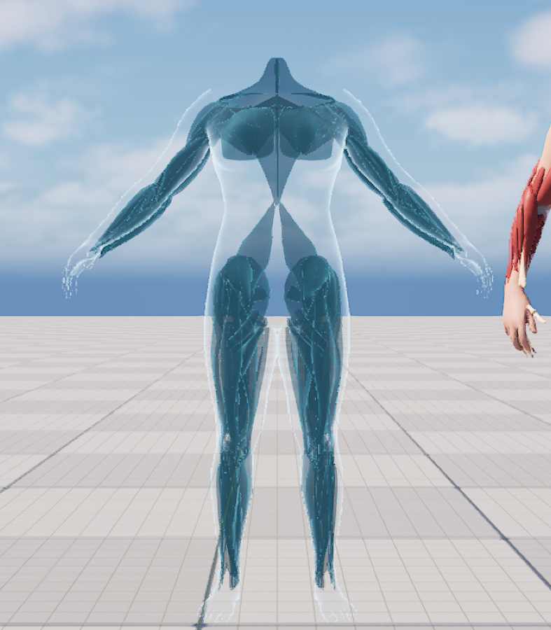
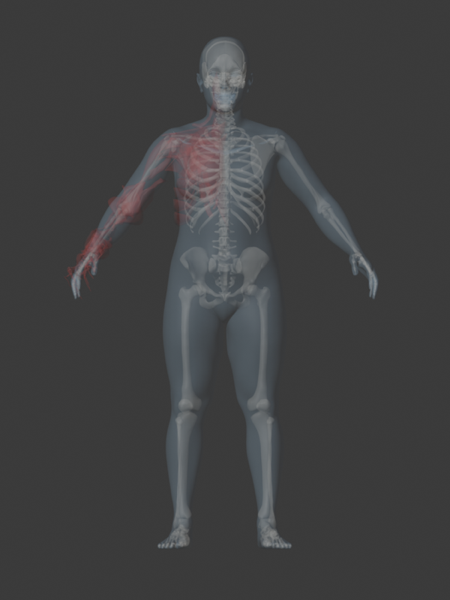
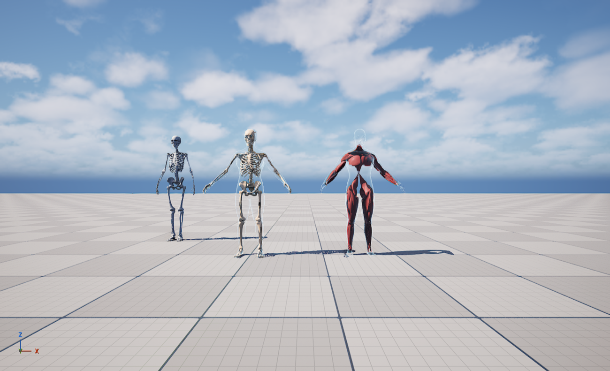
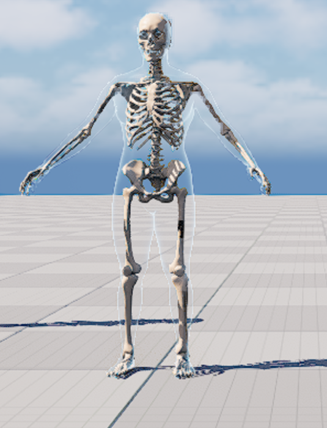
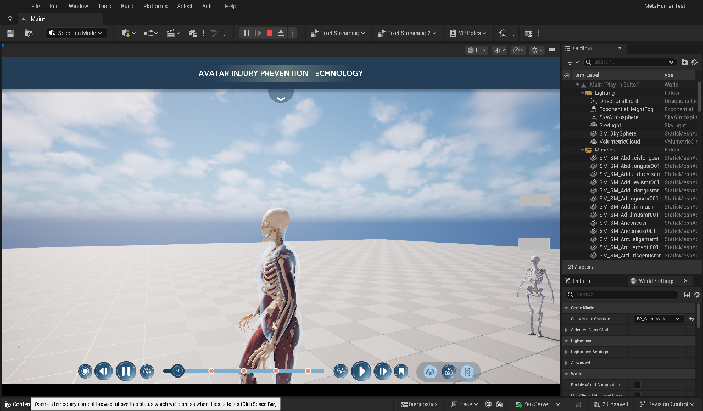

# 04 — Segmented anatomy: muscles and skeleton that follow the run, one label per part

Goal: replace the old Emil upper-body anatomy (one mesh, muscle IDs guessed by rules) with **segmented** anatomy,
where every muscle and every bone is its own part with its own name, so labelling is exact and easy.

| Layer | Source | Parts | Vertices | Moves with Abby by |
|---|---|---|---|---|
| Muscles | the 186 `SM_SM_*` actors in `Main` → folder **Muscles** (93 muscles / ligaments / tendons × left + right) | 186 | 100,948 | **smooth skin weights** transferred from Abby's body |
| Skeleton | `BlenderContent/Skelly_Base.blend` (decision: named + already fitted to Abby, see [02](02-blender-content.md)) | 200 | 183,048 | **rigid**: each bone 100 % on one MetaHuman bone |

Both end up as skeletal meshes on a plugin copy of Abby's skeleton (`SK_Anatomy_MetaHumanBody`, MetaHuman bone
names), so they follow `Body` through **Leader Pose** exactly like the old layers — no Anim Blueprint of their own,
whatever drives the body (timeline ABP, Sequencer, Live Link).

## 1. Where the level's muscles sit

The muscle actors all share one transform: pivot **(320, 80, 0)**, scale 0.00098. Putting Abby's body
(reference pose, x-ray material) on that pivot shows the set was laid out on Abby — only the pivot offset separates
them ([job 05](../scripts/ue_jobs/05_overlay_body_on_muscles.py)):

So: muscle (component space) = actor transform − (320, 80, 0).

## 2. Fitting the Skelly skeleton to Abby (Blender, headless)

`Skelly_Base.blend` has the skeleton inside an Abby A-pose model at ~1/7.5 scale, but its arms / legs are not posed
exactly like the MetaHuman reference pose (matching its muscles to the level's gave 7–10 cm errors in the lower legs
and forearms). [`scripts/blender_jobs/01_export_fitted_skeleton.py`](../scripts/blender_jobs/01_export_fitted_skeleton.py):

1. **Global fit** Skelly → Abby (UE cm, +X = left, +Y = front): uniform scale **7.529** + translation, least squares
   on hips, shoulders and the head joint — residuals 0.25 / 0.93 / 0.76 cm.
2. **Per-segment fit** so the joints land exactly on Abby's joints (Abby's reference pose from
   [job 07](../scripts/ue_jobs/07_dump_body_ref_pose.py)): femur → thigh…calf, tibia / fibula / patella → calf…foot,
   tarsals / metatarsals / toes → foot…ball, humerus → upperarm…lowerarm, radius / ulna → lowerarm…hand,
   hand bones → hand…middle_01. Bones are stretched **along their length only** (thickness kept); the hand is only
   re-oriented. Torso, skull, clavicles and scapulae keep the global fit (MetaHuman's clavicle bone starts next to the
   spine, not at the sternum).
3. Pieces: 199 named bone meshes; left out: the unused `Troracic Verts` sculpt set (at the origin), `Thyroid.001`
   (duplicate), the hidden interosseous membrane. Modifiers evaluated except Subdivision (real-time budget). Mirrored
   rib meshes split into **left / right** by loose parts → **200 parts**.
4. Each part gets a readable name, side, region and the MetaHuman bone it rides on
   ([`data/skeleton_parts.json`](../data/skeleton_parts.json)), e.g. *Rib 7 (true rib)* / Left / Rib cage /
   `spine_04`, *Distal phalanx of the index finger* / Right / Hand / `index_03_r`, *T5 vertebra* → `spine_04`,
   *Femur* → `thigh_l`, *Patella* → `calf_l`.
5. One binary FBX; every part has its own material `P###` so the part ID survives the import as the section index.

## 3. Building the layers in Unreal (Geometry Script, no armature round trip)

[`scripts/ue_jobs/08_build_segmented_anatomy.py`](../scripts/ue_jobs/08_build_segmented_anatomy.py) — all in
the editor, so the bind pose is **exactly** Abby's (no Blender armature round trip that could tilt bone axes and
break Leader Pose):

1. Copy Abby's body (`SKM_MH_CH_Abby5_BodyMesh`) into a DynamicMesh **with its bones and skin weights**.
2. Muscles: copy each `SM_SM_*` static mesh, apply its actor transform minus the pivot, append; remember which
   vertices belong to which part. Skeleton: import the FBX as a static mesh, read the triangle material IDs →
   part IDs.
3. Weights — muscles: `TransferBoneWeightsFromMesh` (closest point on Abby's body surface), so they bend at the
   joints like her skin. Skeleton: `CopyBonesFromMesh` + every vertex of a part set to its one bone (weight 1).
4. Part ID → vertex colour **R = (id + 0.5) / 255** (the convention the picker and highlight material already use).
5. `CreateNewSkeletalMeshAsset` on `SK_Anatomy_MetaHumanBody`, one material (`M_Anatomy_Muscle` /
   `MI_Anatomy_Bone`).
6. Picking samples: per part up to 24 (muscles) / 12 (bones) points spread over it by farthest-point sampling,
   each stored relative to its bone in the reference pose.

Reference-pose check: segmented skeleton (centre) and muscles (right) inside Abby's body + face, the old generic
`SKELeton` asset on the left ([job 09](../scripts/ue_jobs/09_fit_check_segmented.py)):

Read-back check: copying `SKM_Anatomy_Skeleton_Segmented` back into a DynamicMesh gives vertex-colour IDs 1…200,
all 200 distinct — the IDs survive the skeletal-mesh build.

## 4. Labels (atlases)

[`scripts/ue_jobs/10_build_atlases.py`](../scripts/ue_jobs/10_build_atlases.py) → `UMuscleAtlas` data assets:

| Asset | Entries | Samples | Text |
|---|---|---|---|
| `DA_Atlas_Muscles_Segmented` | 186 | 2,000 | Name / side / region + *What it does*, *When running*, *Watch out for* for all 93 muscles, ligaments and tendons ([`data/muscle_info.json`](../data/muscle_info.json)) |
| `DA_Atlas_Skeleton_Segmented` | 200 | 1,736 | Name / side / region + the same three lines per bone type ([`data/bone_info.json`](../data/bone_info.json)) |

Readable names come from `Skelly_Base.blend`'s collection names (typos fixed: *Poliicis* → Pollicis, *Hallicus* →
Hallucis, *Piriformus* → Piriformis, *Suprespinatus* → Supraspinatus...), six set by hand
([`data/muscle_names.json`](../data/muscle_names.json)). Side comes from the geometry (centre x < 0 → Right).

## 5. Wiring ([job 11](../scripts/ue_jobs/11_wire_segmented_layers.py))

`BP_MH_CH_Abby8` and `BP_Beau_Pawn`:

| Component | Now |
|---|---|
| `MuscleMesh` | `SKM_Anatomy_Muscles_Segmented` (Leader Pose = Body, unchanged) |
| `SkeletonMesh` | `SKM_Anatomy_Skeleton_Segmented` |
| `AnatomyPicker` | atlas `DA_Atlas_Muscles_Segmented`, mesh `MuscleMesh`, layer *Muscles*, radius 3 cm |
| **`BonePicker`** (new) | atlas `DA_Atlas_Skeleton_Segmented`, mesh `SkeletonMesh`, layer *Skeleton*, radius 2.5 cm |

A picker only reacts while its layer is the outermost visible one (every outer layer faded), so in the Muscles view
the bones underneath aren't picked and in the Skeleton view the muscles aren't.

C++ for two pickers (rebuilt, *Succeeded*):
* `CPP_PlayerController::UpdateMusclePicking` drives **every** `UAnatomyPickerComp` on the pawn.
* `UCPP_UW_MuscleInfo` binds to every picker, shows whichever one hovers / selects, keeps one popup at a time, and
  hides popup lines that have no text.
* `UCPP_MouseFunctionComp::OrbitFromMouse / ZoomCamera / PanFromMouse` are now `BlueprintCallable` (scripted camera
  moves for screenshots and future UI).

First PIE with the segmented muscles (IHPC **Muscles** button):

