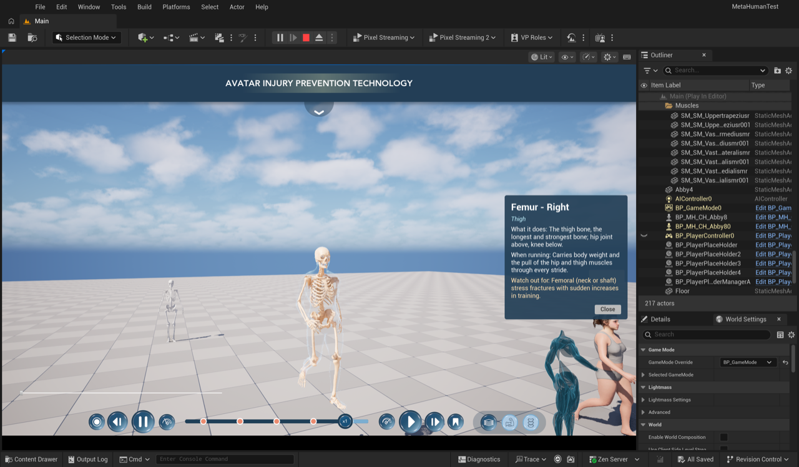
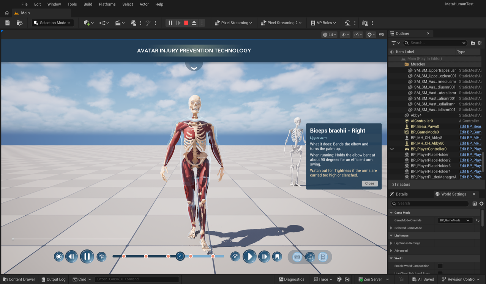

# 05 — Testing in Play-In-Editor

All tests run in `Claude/MetaHumanTestCOPY2` with the merged C++ (build *Succeeded*) through the editor bridge.

> **2026-11-08 (COPY2B):** the layer buttons now go to skin amounts 1 / 0.5 / 0 (depths 0 / 0.5 / 1), a bug that froze
> the button animation after one frame is fixed, and the highlight glow is fixed for muscles and bones. The tests of
> that session (real clicks on the UI, Actions menu, Madi) are in [docs/06 §7](06-actions-characters-highlight.md#7-tests-play-in-editor-2026-11-08).
> The table below is the original (2026-11-07) state.

## Layer switcher → anatomy layers

`tools/ue/pie.sh layer:<body|muscles|skeleton>` calls `WBP_IHPC_LayerSwitcher.SelectLayer` (= clicking the button):

| Button | Reveal depth | Layer opacities (Skin / Muscles / Skeleton) | Active picker |
|---|---|---|---|
| Body | 0.000 | 1.0 / 0.0 / 0.0 | none |
| Muscles | 0.333 | 0.0 (x-ray shell) / 1.0 / 1.0 | `AnatomyPicker` |
| Skeleton | 1.000 | 0.0 / 0.0 / 1.0 | `BonePicker` |

Switching pawn (`pie.sh switch:1` → Beau) re-binds the switcher: its highlight jumps back to **Body** because Beau
starts at the skin; the buttons then drive Beau's `AnatomyView`.

## Picking ([job 12](../scripts/ue_jobs/12_pie_pick_test.py))

The test aims a ray from the player camera at a point on a named part, feeds it to every picker on the pawn, selects,
and reads back the `WB_MuscleInfo` tooltip and popup. The picker returns the **front-most** part along the ray, so
parts hidden behind others (seen from the current camera) correctly return the part in front.

Skeleton view, Abby (after the denser samples, radius 1.5 cm):

| Aimed at | Picked | Tooltip / popup |
|---|---|---|
| Femur (Right) | Femur – Right | ✓ "Femur (Right)" / "Femur - Right · Thigh · What it does: The thigh bone…" |
| Tibia (Right) | Tibia – Right | ✓ |
| Radius (Right) | Radius – Right | ✓ |
| Patella (Left) | Patella (kneecap) – Left | ✓ |
| T8 vertebra | Rib 5 – Left (in front of it) | occlusion |

Muscles view: Biceps brachii (Right) on Beau → *Biceps brachii – Right* ✓; Trapezius (upper) → *Trapezius (upper)*
✓; parts behind others return the one in front (e.g. Gluteus medius seen from the front → Psoas major).

## IHPC timeline → `UAnimationTimelineComp`

Through `UIHPCUILibrary` (what every IHPC timeline button calls), on the possessed pawn (Beau):

| Call | Result |
|---|---|
| `IsAvatarPlaying` / `GetAvatarPlaySpeed` / `GetAvatarTimelineTime` | true / 1.0 / 0.51 |
| `PauseAvatar` | playing → false |
| `SeekAvatarTimeline(0.25)` | t = 0.25, stays paused |
| `SetAvatarPlaySpeed(1.5)` | 1.5 |
| `PlayAvatar` | playing → true |

## Known limitations / next steps

* **The level's muscle set has no trunk muscles** (no abdominals, obliques, latissimus, erector spinae, serratus,
  intercostals, neck or face muscles), so the rib cage, spine and skull show in the Muscles view. Adding them needs
  segmented trunk muscles (Skelly_Base has only some trunk muscles; the old Emil anatomy has them but as one mesh).
* **Picking is sample-based** (points on each part within a radius of the mouse ray). Exact triangle picking
  against the CPU-skinned mesh would make every hover pixel-accurate.
* **Two Abbys in PIE**: the game mode spawns `BP_MH_CH_Abby8` and the level also has one placed at (420, 80, 0); the
  source muscle actors (`Muscles` folder) and the generic `SKELeton` are still visible in the level. Hide or move
  them if they distract.
* `BP_MH_CH_Abby8` still has a stale soft reference to a PIE world (`/Game/UEDPIE_0_Main`) inherited from the Abby
  branch; it only shows in asset validation.
* The layer switcher's highlight follows button clicks and pawn switches; if something else moves the reveal depth,
  the highlight is not updated.
