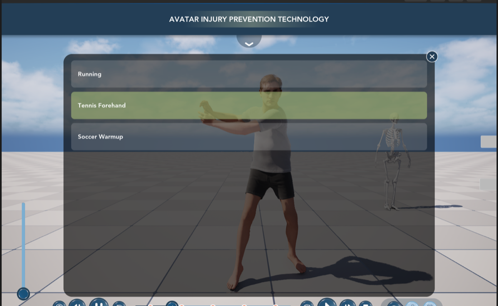
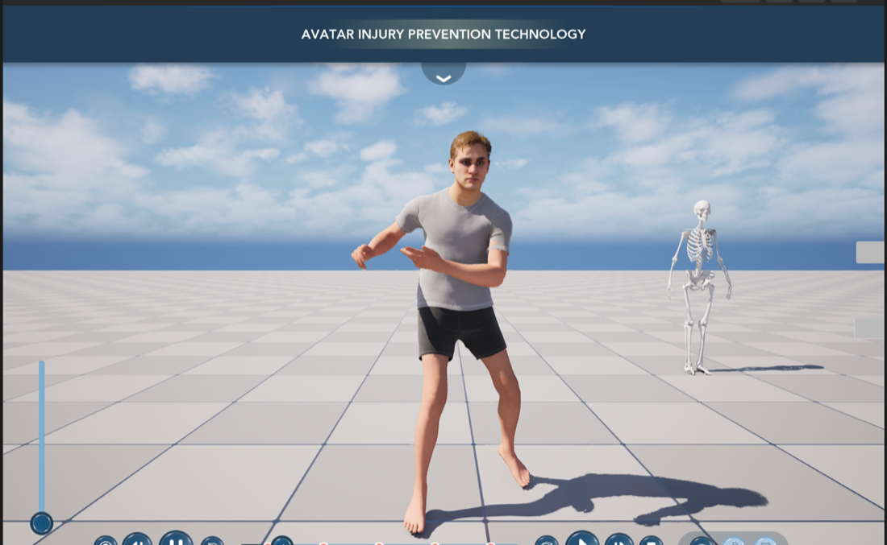
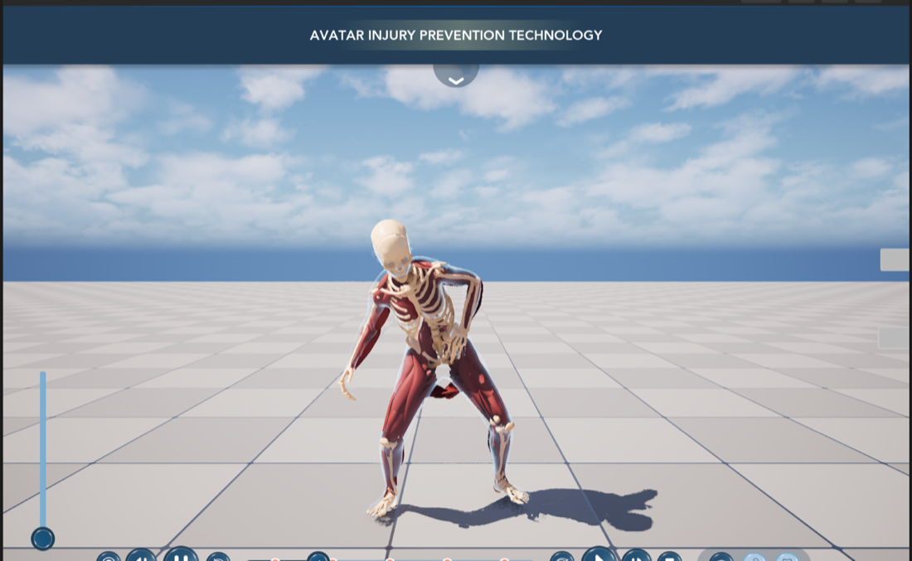
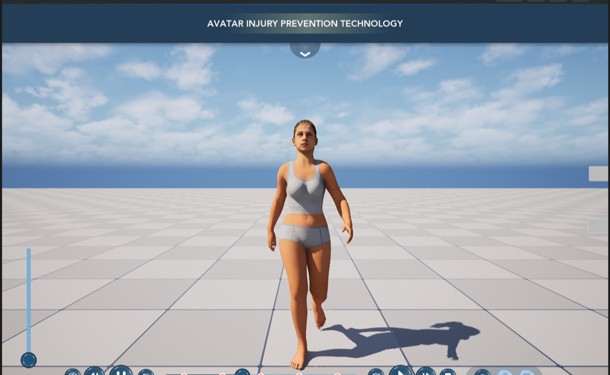
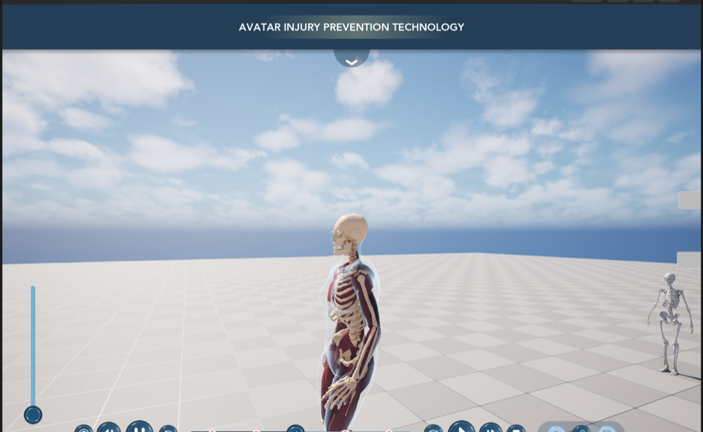
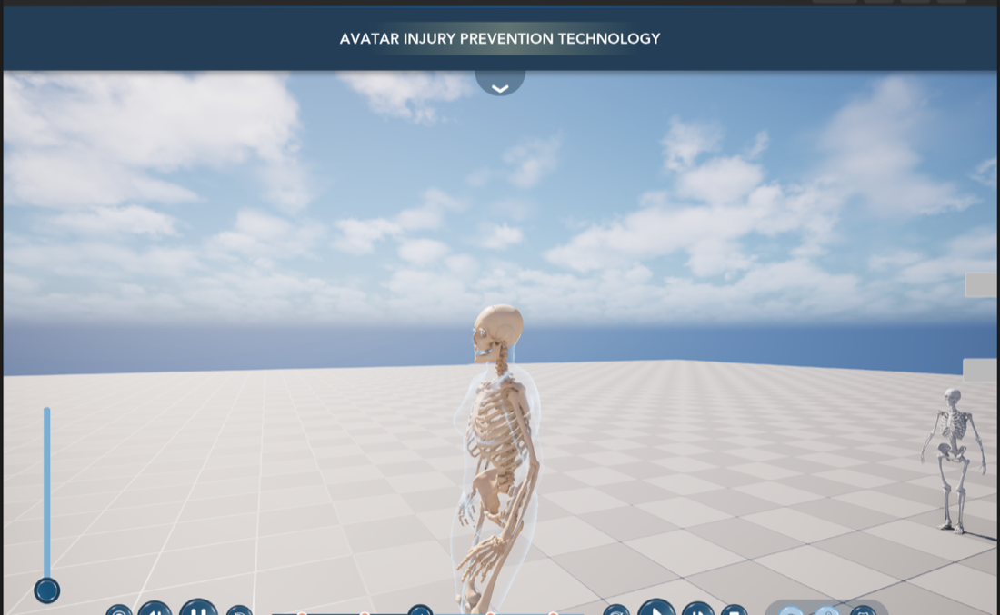
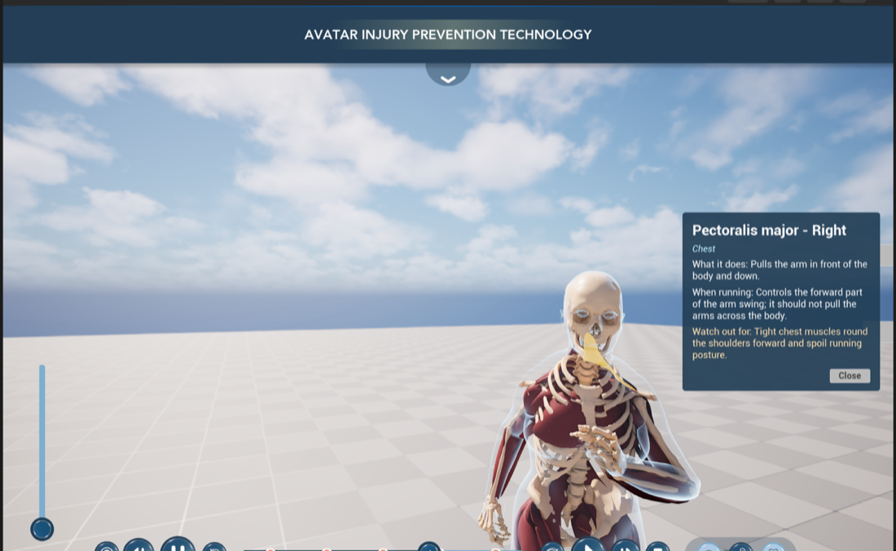
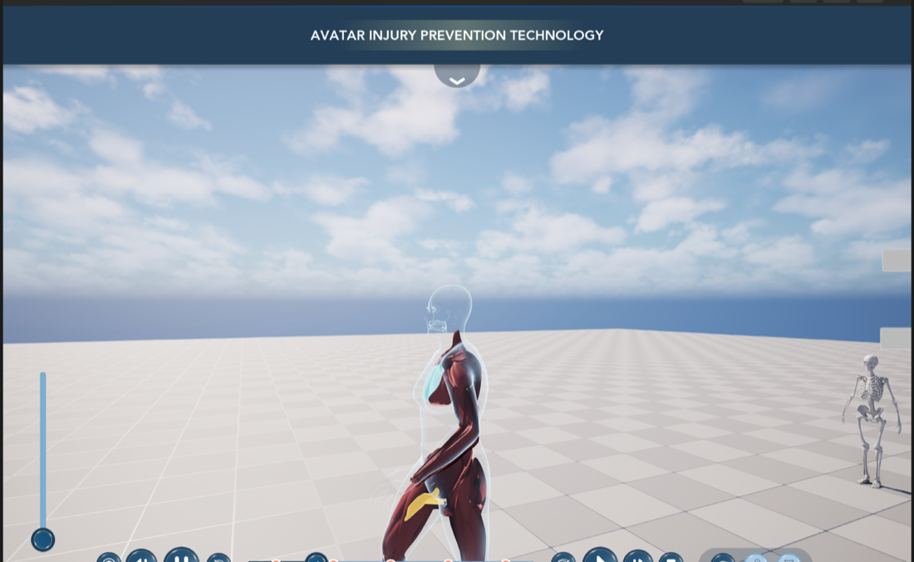
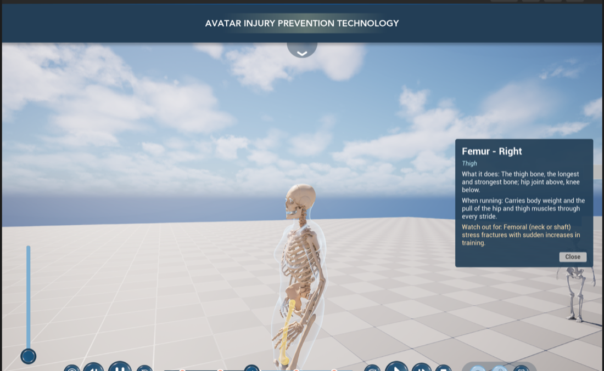

# 06 — Actions menu, Madi (+ Grant), layer buttons 1 / 0.5 / 0, muscle & bone highlight fix

Session of **2026-11-08**, project `Claude/MetaHumanTestCOPY2B` (a copy of COPY2 with the team's manual changes), Unreal
Engine 5.8.4. Everything below was built, run and checked in Play-In-Editor through the Unreal MCP server
(`unreal-copy2`, port 8001) and the editor Python bridge (`tools/ue/claude_bridge.py`).

| Requested | Result |
|---|---|
| Make the new **Actions** menu work (Running / Tennis Forehand / Soccer Warmup change the animation) | ✅ every `Action_<Name>` button plays that clip on the possessed pawn; second click → back to walk / jog / run |
| Add **MadiMHCharacter** and **GrantMHCharacter** with muscles + bones + walking, switchable | ✅ **Madi** assembled, pawn `BP_Madi_Pawn`, in the pawn switcher · ⚠️ **Grant** blocked: needs your MetaHuman cloud login (see [Grant](#grant--what-is-left)) |
| Fix the muscle **hover highlight** (nothing lit up) | ✅ two bugs fixed (highlight mesh name clash + IDs in the vertex colours); muscles **and** bones now glow on the right part |
| Layer buttons: left = **1** (all skin), middle = **0.5** (muscles), right = **0.0** (bones) | ✅ exact skin amounts; a third bug (the buttons froze after one frame) fixed |
| Check the manual code changes, update GitHub, document | ✅ your changes kept and compiled; this repo + docs updated |



---

## 1. Actions menu

### What the user sees

* Menu (chevron) → **Actions** tab (the 4th tab, `Tab_HistoryTimeline`, relabelled "Actions" in `WBP_IHPC_HUD`) opens
  the panel with **Running**, **Tennis Forehand**, **Soccer Warmup** (`Action_Running`, `Action_TennisForehand`,
  `Action_SoccerWarmup` inside `HistoryTimelinePanel > ActionsList`, built by the team).
* Click an action → the avatar plays it from the start, looping; the panel closes so the avatar is visible.
* The timeline bar (play / pause / slower / faster / scrub / restart) drives the action clip exactly like the walk.
* Muscles / skeleton / clothes / face follow (Leader Pose), and hover / click info keeps working during an action.
* Re-open the panel: the playing action is **green** (`#B3CA7F`, like the selected nav tab). Click it again → back to
  the walk / jog / run locomotion (speed slider).
* A pawn without clips (the plain skeleton model) shows the three buttons **greyed out**.

| Beau, Tennis Forehand (retargeted clip) | Madi, Soccer Warmup, Muscles view |
|---|---|
|  |  |

### How it works

```
WBP_IHPC_HUD (UCPP_UW_IHPCHud)                      possessed pawn
  Action_Running ──┐                                  UAnimationTimelineComp
  Action_Tennis... ├─ UIHPCActionButtonProxy ─► HUD::SelectAction("Running") ─► PlayAction("Running")
  Action_Soccer... ┘   (one per button)                 ActionClips["Running"] = AS_Running (Abby) / AS_Running_MH (MH)
                                                        Body mesh -> single-node mode with the clip,
                                                        timeline owns the clock (play/pause/scrub/speed)
                                                      StopAction() -> Body back to its Anim BP (ABP_*_Timeline)
```

* **`UAnimationTimelineComp`** (`Source/MetaHumanTest/Public/AnimationTimelineComp.h`) — new:
  `TMap<FName, UAnimSequenceBase*> ActionClips`, `bLoopActions`, `PlayAction(Name)`, `StopAction()`,
  `GetCurrentAction()`, `IsPlayingAction()`, `HasAction(Name)`, event `OnActionChanged`.
  `ResolveTarget()` plays the action clip in *SingleClip* mode, and when the action stops it puts the mesh back into
  *AnimationBlueprint* mode (re-creates the locomotion anim instance) before driving it again. A clip made for another
  skeleton is refused (logged) and the pawn stays on its locomotion.
* **`UCPP_UW_IHPCHud`** (`Public/IHPC_UI/CPP_UW_IHPCHud.h`) — new: finds **every Button whose name starts with
  `Action_`** (`ActionButtonPrefix`) and binds it through a tiny `UIHPCActionButtonProxy` (a button's `OnClicked` has
  no parameters, the proxy remembers the action name). `SelectAction`, `GetPlayingAction`, `RefreshActionButtons`
  (green highlight + greyed out per pawn; refreshed on click, when the panel opens and when the pawn changes),
  `bCloseActionsPanelOnSelect`, `ActionSelectedColor`, event `OnActionChanged`.
* **Clips per pawn** — `ActionClips` lives on each pawn's timeline component because each skeleton needs its own clip:

| Pawn | Body skeleton | Action clips |
|---|---|---|
| `BP_MH_CH_Abby8` | `SKM_MH_CH_Abby5_BodyMesh_Skeleton` | `/Game/MadisonAnimations/AS_Running`, `AS_MP_MocapTennisTest`, `AS_SoccerFeintWarmup` (the originals) |
| `BP_Beau_Pawn`, `BP_Madi_Pawn` (and Grant) | `metahuman_base_skel` (MetaHuman Character plugin) | `/Game/MadisonAnimations/MetaHuman/AS_*_MH` — retargeted with `RTG_MH_IKRig` ([job 15](../scripts/ue_jobs/15_retarget_actions_to_metahuman.py)) |
| `BP_SkeletonModel` | – | none → buttons greyed out |

  [Job 17](../scripts/ue_jobs/17_wire_actions_and_layers.py) fills `ActionClips` on every pawn of the pawn switcher,
  choosing originals or `_MH` copies from the Body mesh's skeleton.

* **The clips** (`/Game/MadisonAnimations`, from `MadisonAnimationSequences/*.FBX`): Running 4.17 s, Tennis Forehand
  3.03 s, Soccer Warmup 11.9 s, no root motion, no sync markers. They are mocap: the pelvis moves up to ~1 m during a
  loop (the tennis step goes ~70 cm forward) and Running faces the camera; kept as recorded.

### Why the manual `SetWalkAnimation` attempt didn't change the animation

`UCPP_LocomotionAnimInstance::SetWalkAnimation` (your addition, kept, now `public`) swaps `WalkAnim` and rebuilds the
gait-cycle timing — but the AnimGraph's **Sequence Evaluator nodes reference their clips directly** (the
`Abby_*_Upright` / `Beau_*_Upright` assets are pinned on the nodes), so the pose that is shown never changes; only the
timing does. Playing the action clip on the mesh (above) avoids touching the AnimGraph and works for every pawn.

### Add another action

1. Import the clip (on Abby's skeleton like the others) into `/Game/MadisonAnimations`.
2. In `WBP_IHPC_HUD`, duplicate one of the buttons in `ActionsList`, name it `Action_<Name>` (e.g. `Action_Squat`) and
   change its label. **No C++ change** — the HUD picks up any `Action_*` button.
3. Add `"<Name>": "<clip asset name>"` to `ACTIONS` in job 15 (retarget to `metahuman_base_skel`) and job 17, run
   both (`ue_bridge.py <job>`). Or set the clips by hand: pawn → *AnimationTimelineComp* → *Action Clips*.

---

## 2. New characters

### Madi ✅

| Step | How |
|---|---|
| Assemble `MHC_Madi` (it had never been assembled) | `UMetaHumanCharacterEditorSubsystem.build_meta_human`, Cinematic pipeline → `/Game/MadisonTesting/MadiMHCharacter/Unpacked/MHC_Madi/` (`BP_MHC_Madi`, body, face, ponytail / eyebrow / eyelash grooms; 83 assets, 371 MB — stays in Perforce). [Job 19](../scripts/ue_jobs/19_assemble_metahuman.py) |
| Pawn `BP_Madi_Pawn` | [Job 16](../scripts/ue_jobs/16_make_metahuman_pawn.py): copy of `BP_Beau_Pawn` (camera, `MuscleMesh`, `SkeletonMesh`, `AnatomyView`, `AnatomyPicker`, `BonePicker`, timeline, mouse) with Madi's Body / Face / grooms copied component by component from `BP_MHC_Madi`; Madi has no outfit, so Beau's clothes component is removed (MetaHuman underwear look). |
| Walking | Body keeps **`ABP_Beau_Timeline`**: every MHC-assembled character uses `metahuman_base_skel`, so Beau's upright walk / jog / run play on Madi (feet on the floor, checked). |
| Muscles + bones | The same segmented `SKM_Anatomy_Muscles_Segmented` / `SKM_Anatomy_Skeleton_Segmented` with Leader Pose on Madi's Body — they follow her bones like they follow Beau's. |
| Switching | Added to `BP_PlayerController` → *Switchable Pawn Classes* (index 3: Abby8 → Beau → skeleton model → **Madi**); spawns at `BP_PlayerPlaceHolder4` (−1170, −1030). |



### Grant — what is left

`MHC_Grant` **cannot be assembled yet**: it has no texture sources (only the low-res synthesized face textures), and
the assembler refuses it — *"The Character is missing textures, use Download Texture Sources to create them before
assembling"*. Downloading them needs the MetaHuman cloud service, and the editor is not logged in
(`LogMetaHumanAuth: Login failed - error code: EOS_InvalidAuth`). Re-synthesizing the textures locally does not satisfy
the check (tried, then reverted — `MHC_Grant.uasset` is byte-identical to before).

**To finish Grant (one command after logging in):**

1. In the editor open `MadisonTesting/GrantMHCharacter/MHC_Grant` (MetaHuman Character editor), log in when asked
   (or use *Download Texture Sources* once — it opens the Epic login).
2. With the editor running and the bridge on, run:
   ```sh
   tools/ue/add_metahuman_pawn.sh Grant /Game/MadisonTesting/GrantMHCharacter/MHC_Grant
   ```
   = job 19 (download textures if still missing, assemble to `GrantMHCharacter/Unpacked`) → job 16 (`BP_Grant_Pawn`,
   pawn switcher, adds a 5th spawn placeholder) → job 17 (action clips + layer fade lengths).

---

## 3. Layer buttons: 1 / 0.5 / 0

`UCPP_UW_IHPCLayerSwitcher` now animates to fixed **skin amounts** — the old anatomy slider's scale, 1 = all skin:

| Button | `…SkinAmount` | Reveal depth (1 − amount) | Layer opacities Skin / Muscles / Skeleton | Picker |
|---|---|---|---|---|
| Body (left) | `BodySkinAmount` = **1.0** | 0.0 | 1 / 0 / 0 | – |
| Muscles (middle) | `MusclesSkinAmount` = **0.5** | 0.5 | 0 (x-ray shell) / 1 / 1 | `AnatomyPicker` |
| Skeleton (right) | `SkeletonSkinAmount` = **0.0** | 1.0 | 0 / 0 / 1 | `BonePicker` |

* New: `bUseSkinAmounts` (default on; off = old "jump to the named layer's depth"), the three amounts (editable in
  `WBP_IHPC_LayerSwitcher` → Class Defaults), `GetRevealDepthForLayer()`. The highlight sync after a pawn switch
  uses the same depths.
* **Depth 0.5 = muscles fully shown** needed equal fade lengths: `UAnatomyViewComp` gave Skin → Muscles only a third
  of the range (`Skin.FadeLength = 0.5`), so 0.5 used to be *muscles 75 % faded with bones showing through*. Now
  `Skin.FadeLength = 1.0` — the plugin default and on every pawn (job 16 / 17).

| Muscles button (0.5) | Skeleton button (0.0) |
|---|---|
|  |  |

### Bug fixed: the buttons froze after one frame

`UCPP_UW_AnatomyViewSwitcher` (the base class) mirrors the depth onto its hidden slider every time it changes.
`USlider::SetValue` **fires `OnValueChanged`**, which the base class forwarded back as
`SetRevealDepth(depth, bAnimate = false)` — that set the target to the *current* depth and stopped the animation after
its first frame (measured: every button stopped at depth ≈ 0.04 → skin as x-ray, muscles shown, **never the bones**).
Fix: `SetSliderSilently()` + `bSyncingSlider` guard (`Private/CPP_UW_AnatomyViewSwitcher.cpp`). Verified with real
clicks on the three buttons: 0.5 / 1.0 / 0.0 reached.

---

## 4. Muscle / bone highlight

The picker always found the right part (name tooltip + info popup were right), but the **glow** was missing or on the
wrong part. Two separate bugs:

### Bug 1 — both pickers shared one highlight mesh

Each `UAnatomyPickerComp` makes a translucent copy of its mesh that draws the glow. Both used the fixed name
`"MuscleHighlight"`, so when `BonePicker` created its copy, `NewObject` **re-created the muscle picker's copy in place**:
one component, with the skeleton mesh and the bone picker's material. The muscle picker then set `HoverId` on a
material that wasn't on any mesh → muscles never lit up. Fix: unique names (`AnatomyPicker_Highlight_0`,
`BonePicker_Highlight_0`) via `MakeUniqueObjectName` (`Plugins/MetaHumanAnatomyLayers/.../AnatomyPickerComp.cpp`).

### Bug 2 — the part IDs in the vertex colours were wrong on the GPU

`M_Anatomy_MuscleHighlight` lights the vertices whose `round(VertexColor.R × 255)` equals `HoverId` / `SelectedId`.
Job 08 wrote ID *k* as `(k + 0.5) / 255`, but writing the skeletal mesh treats Geometry Script vertex colours as
**sRGB** and converts them to linear before making the 8-bit render data — the GPU got `round(255 × sRGB→linear((k+0.5)/255))`:

| Selected | Lit instead | |
|---|---|---|
| Pectoralis major R (117) | Trapezius (upper) L (180) |  |
| Femur R (74) | Cuboid R (147) — a foot bone | |
| IDs 1 … ~40 | squeezed into bytes 0 … 6 — unreachable | |

(Proved with a debug material showing `frac(VertexColor.R × 255)` = 0 everywhere: whole bytes, i.e. the conversion
happened at build time, not in the shader.) Fix: [job 18](../scripts/ue_jobs/18_fix_part_id_vertex_colors.py)
rewrote the colours **in place** as `linear→sRGB((k + 0.25) / 255)` so the stored byte is exactly *k* — same assets,
vertices, weights and materials (Blueprints keep their references); verified 100 948 / 100 948 muscle and
183 048 / 183 048 bone vertices. Job 08 now writes and reads the IDs the same way.

| After: pectoralis (hover, cyan) + adductor longus (selected, orange, ID 5) | After: femur selected |
|---|---|
|  |  |

---

## 5. The team's manual code changes (checked, kept, compiled)

| File | Change | Status |
|---|---|---|
| `CPP_UW_IHPCHud.cpp` | `KeepTabSeparatorsOnePixelWide` — nav-bar separators stay 1 screen pixel at UI scales < 1 | kept |
| `CPP_UW_SpeedSlider.cpp` | `SyncSpeedTrack` — optional `SpeedTrack` progress bar under the slider | kept |
| `CPP_LocomotionAnimInstance.h/.cpp` | `SetWalkAnimation`, `WalkAnim` EditAnywhere / BlueprintReadWrite | kept; moved to `public`, comment explains it changes timing only (see §1) |
| `CPP_WBP_SpeedSlider.h/.cpp` | unused stub (commented out) | kept as is |
| `BP_SpeedSlider`, `ABP_Abby_Timeline`, `WBP_IHPC_HUD` | Blueprint edits (speed track, Actions panel) | kept, mirrored into `project/` |

These had **never been compiled** in COPY2B (the newest library was from 2026-11-07 21:18, before the edits); the
build of this session compiled them without errors.

---

## 6. Files changed in this session

**C++** (`Source/MetaHumanTest`): `Public/AnimationTimelineComp.h`, `Private/AnimationTimelineComp.cpp` (actions) ·
`Public/IHPC_UI/CPP_UW_IHPCHud.h`, `Private/IHPC_UI/CPP_UW_IHPCHud.cpp` (Actions menu) ·
`Public/IHPC_UI/CPP_UW_IHPCLayerSwitcher.h`, `Private/IHPC_UI/CPP_UW_IHPCLayerSwitcher.cpp` (skin amounts) ·
`Public/CPP_UW_AnatomyViewSwitcher.h`, `Private/CPP_UW_AnatomyViewSwitcher.cpp` (slider echo fix) ·
`Public/CPP_LocomotionAnimInstance.h` (`SetWalkAnimation` public + comment).
**Plugin** (`Plugins/MetaHumanAnatomyLayers`): `AnatomyPickerComp.cpp` (unique highlight names), `AnatomyViewComp.cpp`
(`Skin.FadeLength = 1`), `SKM_Anatomy_Muscles_Segmented`, `SKM_Anatomy_Skeleton_Segmented` (vertex-colour IDs).

**Assets**: `BP_MH_CH_Abby8`, `BP_Beau_Pawn` (action clips, fade length) · new `BP_Madi_Pawn` · new
`MadiMHCharacter/Unpacked/MHC_Madi/*` (assembly) · new `MadisonAnimations/MetaHuman/AS_*_MH` · `BP_PlayerController`
(Madi in the switcher) · `Main` (re-saved after the Blueprint recompiles; no content change).

**Scripts / tools (this repo)**: jobs [15](../scripts/ue_jobs/15_retarget_actions_to_metahuman.py) (retarget),
[16](../scripts/ue_jobs/16_make_metahuman_pawn.py) (pawn from an assembled MetaHuman),
[17](../scripts/ue_jobs/17_wire_actions_and_layers.py) (action clips + fade lengths on every switchable pawn),
[18](../scripts/ue_jobs/18_fix_part_id_vertex_colors.py) (vertex-colour IDs),
[19](../scripts/ue_jobs/19_assemble_metahuman.py) (assemble an MHC); job 08 encode/decode updated;
`tools/ue/add_metahuman_pawn.sh`; tool defaults now point at COPY2B.

**Backups** of every changed file: `COPY2B/Saved/ClaudeBackup/2026-11-08/` (Source, plugin Source, the Blueprints,
HUD, layer switcher, `MHC_Grant`, both segmented meshes, `Main.umap`).

## 7. Tests (Play-In-Editor, 2026-11-08)

| Test | Result |
|---|---|
| Actions tab opens the panel with the 3 buttons | ✅ |
| Real click on *Running* (Abby) | ✅ Body → single node `AS_Running`, 4.17 s cycle, playing; panel closed |
| *Soccer Warmup* on Madi, *Tennis Forehand* on Beau (retargeted clips) | ✅ (`…_MH` clips, single-node mode) |
| Re-open panel: playing action green; click it again | ✅ back to `ABP_Beau_Timeline`, 0.967 s gait cycle |
| Skeleton model: action buttons | ✅ all three disabled |
| Real clicks on the layer buttons | ✅ Muscles 0.5 (`AnatomyPicker` active) · Skeleton 1.0 (`BonePicker` active) · Body 0.0 |
| Two separate highlight meshes | ✅ `AnatomyPicker_Highlight_0` (muscles), `BonePicker_Highlight_0` (bones) |
| Glow on the selected part | ✅ pectoralis, adductor longus (ID 5), femur — right part |
| Pawn switch → Madi | ✅ walks with her own body / face / hair; muscles + skeleton follow; bone picking popup "Femur – Right" |
| Output log | no new warnings / errors from the project code |

## 8. Known limitations (new)

* **Grant** needs the MetaHuman login first (§2).
* **Stretched inner-thigh muscle in deep, wide stances** (e.g. Soccer Warmup): the muscle weights were transferred from
  Abby's body by closest point; extreme hip abduction stretches a flap between the legs.
* **Action clips face their recorded direction** (Running runs towards the camera) and drift up to ~1 m before
  looping; orbit / pan the camera, or add root-lock / in-place versions of the clips if needed.
* Madi uses Beau's retargeted walk (same skeleton); a Madi-specific retarget would match her proportions exactly.
